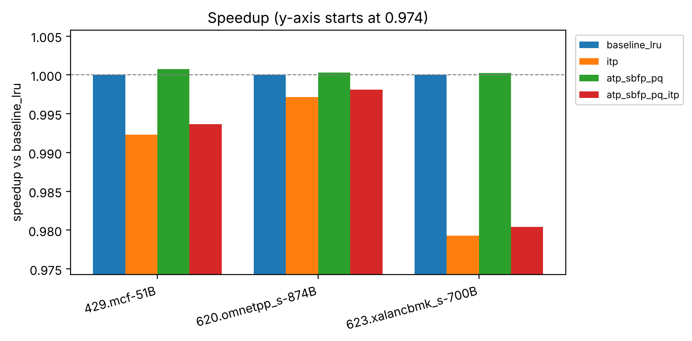
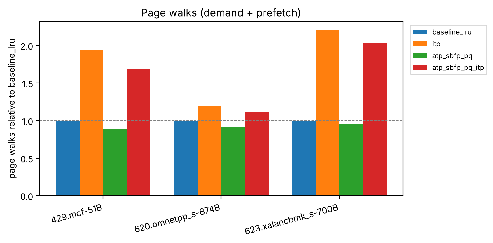
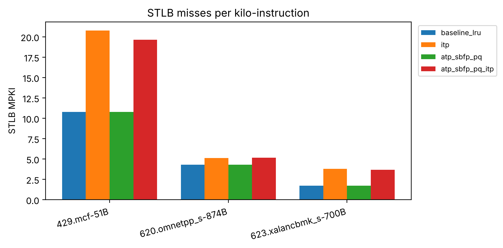
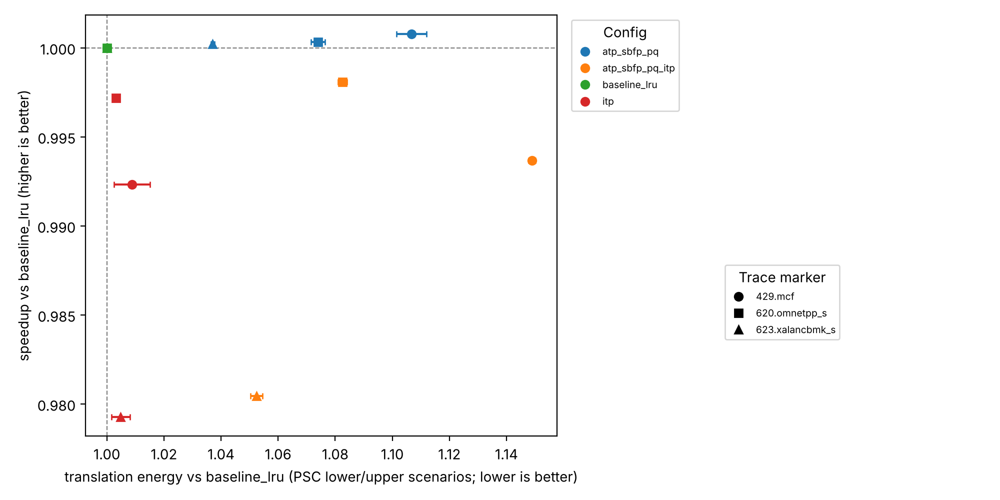
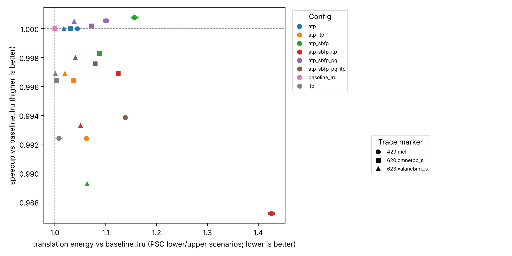
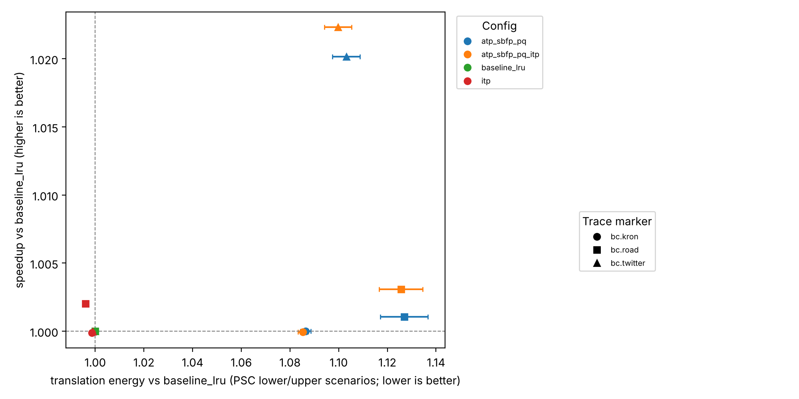
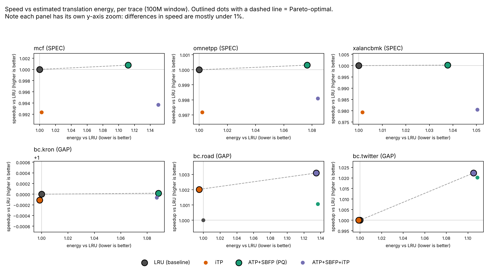
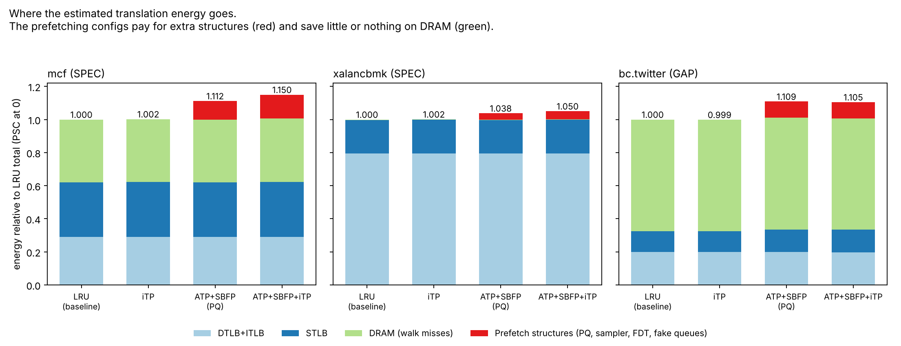
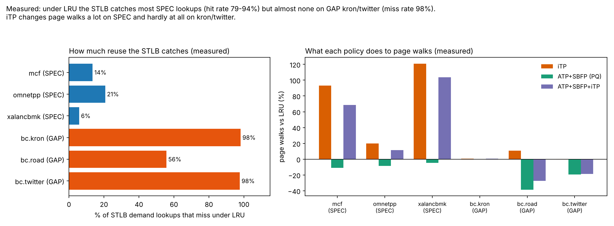

# Energy-Aware Evaluation of TLB Prefetching and Replacement

**CECS 532 — Memory Design Implementation | CSULB Fall 2026 | Group 6**

This repository contains the simulation infrastructure and results for a trace-driven study of TLB prefetching (ATP with SBFP) and second-level TLB (STLB) replacement (iTP). ChampSim has no energy model, so we add access-level energy accounting based on CACTI and compare configurations by speedup and estimated translation energy.

---

## Research Question

> Which TLB prefetching and STLB replacement policies provide the best trade-off between execution speed and estimated translation energy?

**Objectives**
1. Measure speedup and estimated translation energy for each configuration.
2. Identify Pareto-optimal configurations.
3. Characterize which workload types (for example irregular versus regular access patterns) favor which policy, to inform TLB design choices. This follows from the proposal's expected workload dependence.

We answer it by simulating a baseline (LRU replacement, no TLB prefetching), ATP/SBFP, iTP and their combination in ChampSim. Speedup and estimated energy are compared to identify Pareto-optimal configurations.

**Hypotheses (stated before the experiments).** The trade-off should vary by workload: aggressive prefetching should raise speed but also energy on irregular workloads, and free prefetching (SBFP) should be among the most efficient. The experiments may instead show one policy to be best on both measures, which is also a useful result.

**Outcome (100M-instruction runs, nine traces: three SPEC, three GAP, three regular SPEC).** The energy half of the hypothesis holds: prefetching raises estimated energy by 4% to 15% on every trace. The speed half mostly does not: ATP+SBFP is within about 0.4% of LRU on seven traces and gains 2.0% on `bc.twitter-1658B`; it is 2.1% slower on the regular trace `649.fotonik3d_s-1176B`. Free prefetching (SBFP) was expected to be among the most efficient, but it is not: it costs energy and saves almost no time here. No policy beats LRU on both measures on SPEC. On GAP, iTP is marginally ahead of LRU on energy (0.1% to 0.5% lower) with speed within 0.2%. The fastest policy is never the lowest-energy one. See [Answers to the objectives](#answers-to-the-objectives).

## Background

Every memory access needs a virtual-to-physical translation. Translations are cached in the TLB hierarchy (DTLB/ITLB, then a shared STLB). An STLB miss triggers a page-table walk, which issues dependent memory references and can stall the core for hundreds of cycles. Two lines of work reduce this cost:

- **Agile TLB Prefetching (ATP) with Sampling-Based Free TLB Prefetching (SBFP).** ATP selects among several TLB prefetchers at run time. SBFP exploits the fact that a page-table walk fetches a cache line holding neighbouring PTEs and keeps the useful ones as "free" prefetches [1].
- **iTP (instruction-aware STLB replacement).** iTP biases STLB replacement toward instruction translations, which are more costly to miss, and is designed to cooperate with cache replacement [2].

| Term | Meaning |
|---|---|
| STLB | Second-level (shared) TLB. A miss here starts a page-table walk. |
| Page walk | Hardware lookup of the page table in memory after an STLB miss. |
| PSC | Page-structure cache: caches upper page-table levels to shorten walks. |
| MPKI | Misses per thousand instructions. |
| Speedup | Cycles of `baseline_lru` divided by cycles of the configuration. |
| EDP | Energy-delay product: energy times runtime. Lower is better. |
| Pareto-optimal | No other configuration is both faster and lower-energy. |

Both can reduce page walks, but speculative prefetches consume energy and affect which translations remain in the STLB. Published TLB work mostly reports speedup, and energy is evaluated for only some designs; the ISCA 2021 paper estimates energy with CACTI for its prefetcher [1]. This project compares the policies in one common setup, with speed and estimated energy side by side. Our implementations are simplified versions of the published designs, and every simplification is documented alongside the code.

## Evaluated Configurations

| ID | STLB prefetching | STLB replacement | Status |
|---|---|---|---|
| `baseline_lru` | none | LRU | Required |
| `itp` | none | iTP | Required |
| `atp_sbfp_pq` | ATP + SBFP (free PTEs go to a separate 64-entry prefetch queue, as in the paper) | LRU | Required |
| `atp_sbfp_pq_itp` | ATP + SBFP with prefetch queue | iTP | Required |
| `atp` , `atp_itp` | ATP only (no SBFP) | LRU / iTP | Diagnostic: isolates SBFP's contribution |
| `atp_sbfp` , `atp_sbfp_itp` | ATP + SBFP, free PTEs fill the STLB directly (no prefetch queue) | LRU / iTP | Ablation: shows the cost of STLB pollution |

**What each policy does, and how it ranks.**

| Policy | Mechanism | Effect measured here | Energy rank (1 = lowest) |
|---|---|---|---|
| `baseline_lru` | Evict the least recently used STLB entry; no prefetching | Reference | 1 (tied with iTP) |
| `itp` | Instruction translations are kept longer; data translations are inserted near the eviction end (no xPTP) | Data page walks rise (+20% to +121% on SPEC, 0% to +11% on GAP), so SPEC is slower (−0.3% to −2.1%); GAP speed within +0.2% | 1 (+0.2% on SPEC; −0.5% to −0.1% on GAP) |
| `atp_sbfp_pq` | ATP predicts future pages; SBFP keeps useful neighbour PTEs from each walk in a separate 64-entry queue, so the STLB is not polluted | Walks −5% to −38% except `bc.kron-2608B` (0%); speed within about 0.1% except +2.0% on `bc.twitter-1658B` | 2 (+4% to +14%) |
| `atp_sbfp_pq_itp` | Both | iTP's extra data walks partly cancel the queue's savings on SPEC; on GAP about the same as `atp_sbfp_pq` | 3 on SPEC (+5% to +15%); about tied with 2 on GAP |
| `atp_sbfp`, `atp_sbfp_itp` | Free PTEs fill the STLB directly | Pollutes the STLB; at 10M + 20M the worst energy (up to +43% on `429.mcf-51B`) | 4 (SPEC 10M + 20M only) |

Ranking is by energy versus LRU in the tables under [Results](#results); the exact values are there.

## Methodology

```
 DPC-3 SPEC / GAP traces
        │
        ▼
 ChampSim (pinned, + iTP / ATP / SBFP modules, walker counters)
        │   one binary per configuration (configs/*.json)
        ▼
 raw outputs: cycles, TLB / walker / ATP / SBFP counters   results/raw*/<config>__<trace>.txt
        │                                                      ┌──────────────────────────────┐
        ├──────────────────────────────────────────────────►   │ energy/energy_fusion.py      │
        │                                                      │ counts × CACTI per-access    │──► speedup, energy, EDP
 CACTI 90 nm (22 nm sensitivity) ─► energy/cacti_per_access.csv│ + leakage × runtime + DRAM   │    tables and plots
                                                               └──────────────────────────────┘
```

**Simulator.** [ChampSim](https://github.com/ChampSim/ChampSim), pinned to commit `410cee6` (see `scripts/setup.sh`). It models a TLB hierarchy and a hardware page-table walker with page-structure caches. It ships no TLB-specific prefetcher and no iTP, so these are implemented as ChampSim modules in this project.

**Energy model.** Dynamic energy is access counts times per-access energy. Leakage is added for modeled on-chip structures; L1D, L2C, and LLC translation accesses use dynamic energy only, and ATP fake-queue leakage is counted for all three queues. If cache CACTI rows are unavailable, the script excludes cache energy for page-walk accesses and labels that omission in the result table. PSC is reported with a zero lower bound and an upper-bound proxy copied from the 64-entry fully associative PQ CACTI estimate (64 B block, 90 nm). The proxy is larger than all four PSC geometries (2, 4, 8, and 32 entries); those geometries failed in CACTI with exit code 139.

```
E_dynamic = Σ_s ( reads_s · e_read,s + writes_s · e_write,s )     s ∈ {DTLB, ITLB, STLB, PQ, SBFP tables, PSC}
E_leakage = Σ_s P_leak,s · t_run                                   t_run = cycles / frequency
E_total,lower = E_dynamic + E_leakage + E_pagewalk_memory   (PSC = 0)
E_total,upper = E_total,lower + E_PSC,proxy                (when proxy exists)
EDP_lower/upper = E_total,lower/upper · t_run
```

Per-access energies and leakage come from [CACTI](https://github.com/HewlettPackard/cacti) models of each structure (`energy/cacti_per_access.csv`). Page-walk accesses to DRAM use a separate energy estimate. CACTI requires power-of-two sizes, so the 1536-entry STLB (128 sets × 12 ways) is modeled at nearby power-of-two sizes. This approximation is stated wherever results are reported.

### STLB and page-walk energy inputs

The final energy table uses 90 nm; 22 nm is a technology-node sensitivity comparison. CACTI 7.0.3DD Prerelease (Aug. 2012; repository pin `1ffd8df`) was run with 128 sets, a 64-byte block, a 49-bit tag, and one read/write port. The 64-byte block is a CACTI cache-model proxy, not a literal TLB entry.

| Entries | Node / role | Read energy (nJ/access) | Write energy (nJ/access) | Leakage (mW) |
|---:|---|---:|---:|---:|
| 1,024 (128 × 8) | 90 nm | 0.764013 | 0.766323 | 30.9463 |
| 2,048 (128 × 16) | 90 nm | 1.86933 | 1.94523 | 62.569 |
| **1,536 estimate (128 × 12)** | **90 nm final** | **1.3166715** | **1.3557765** | **46.75765** |
| 1,024 (128 × 8) | 22 nm sensitivity | 0.0838914 | 0.0889089 | 23.0347 |
| 2,048 (128 × 16) | 22 nm sensitivity | 0.192163 | 0.202141 | 44.8915 |
| **1,536 midpoint (128 × 12)** | **22 nm sensitivity** | **0.1380272** | **0.14552495** | **33.9631** |

CACTI did not directly provide the project's 1,536-entry, 128-set × 12-way STLB estimate. We use the arithmetic midpoint for each metric: `E_1536 = (E_1024 + E_2048) / 2`. At 90 nm, the endpoint half-ranges are 0.5526585 nJ/read, 0.5894535 nJ/write, and 15.81135 mW leakage. These are sensitivity indicators, not guaranteed error bounds if CACTI's array organization changes nonlinearly.

The 2,048-to-1,024 ratios are 2.447 read, 2.538 write, and 2.022 leakage at 90 nm; at 22 nm they are 2.291, 2.274, and 1.949. The ratio shifts at 22 nm are −6.38%, −10.43%, and −3.61%, respectively.

For page-walk memory energy, use **56 nJ per 64-byte DRAM read** from David et al. [5]. Table 2 reports this value for DDR3 at 1333 MHz with two DIMMs per channel and labels its average-read row as **page-closed policy**: 18 nJ array read + 1 nJ read I/O + 12 nJ additional termination + 25 nJ activate/pre-charge. Every access therefore pays for opening and closing a page, so reads that hit an already open page would cost less and 56 nJ leans high. We assume one LLC translation miss is one 64-byte read; the Table 2 caption does not state the access size. The 800 MHz row of the same table is 64.7 nJ, so the value depends on memory frequency. This is a published system estimate, not a measurement of our machine; the project applies it once per LLC `TRANSLATION MISS` counted as one DRAM read.

**Metrics.** IPC and speedup over `baseline_lru`; STLB misses (MPKI); page-walk memory references; prefetch accuracy; estimated translation energy; EDP as a derived comparison.

## Experimental Setup

| Item | Value |
|---|---|
| Simulator | ChampSim `410cee6`, single core |
| Core / TLBs | ChampSim defaults: 4 GHz core, STLB 128 sets × 12 ways, 4 KB pages |
| STLB prefetch queue | `pq_size = 8` (default is 0, which disables STLB prefetching) |
| Traces | `429.mcf-51B`, `620.omnetpp_s-874B`, `623.xalancbmk_s-700B`, selected by STLB MPKI (see Trace selection below) |
| Warmup / simulation | 20M warmup + 100M simulated instructions for the four required configurations on the SPEC traces; 10M + 20M for the ablation configurations; 20M warmup + 100M for the four required configurations on the GAP traces as well (a 10M + 20M GAP run is also available) |

### Trace selection

**Why screen traces.** The DPC-3 SPEC traces were assembled for data-cache prefetching, not for TLB behaviour, so we do not assume they stress the STLB. Each candidate is run once with `baseline_lru` (10M warmup + 20M simulated instructions) and ranked by its STLB misses per thousand instructions (MPKI). Traces with high MPKI are kept, because a TLB policy cannot show a difference on a trace that barely misses.

**Result.** 14 traces were screened (the heaviest published SimPoint slice of 12 benchmarks, plus two more mcf slices). Eight of the 14 have an STLB MPKI below 1.

| Trace | SimPoint weight | STLB MPKI | STLB miss latency (cycles) | Instruction share of STLB accesses | Decision |
|---|---|---|---|---|---|
| `429.mcf-51B` | 0.323 | 11.23 | 110.4 | 0.0% | **Selected** |
| `471.omnetpp-188B` | 0.945 | 4.30 | 65.8 | 2.1% | Backup |
| `620.omnetpp_s-874B` | 0.828 | 4.26 | 93.2 | 7.7% | **Selected** |
| `429.mcf-192B` | 0.185 | 2.56 | 144.5 | 0.0% | Backup |
| `429.mcf-22B` | 0.114 | 2.42 | 261.8 | 0.0% | Backup |
| `623.xalancbmk_s-700B` | 0.413 | 1.86 | 23.6 | 0.7% | **Selected** |
| `450.soplex-247B` | 0.487 | 0.94 | 123.9 | 0.0% | Dropped (MPKI < 1) |
| `619.lbm_s-4268B` | 0.418 | 0.73 | 212.5 | 0.0% | Dropped |
| `605.mcf_s-665B` | 0.441 | 0.27 | 146.2 | 0.0% | Dropped |
| `602.gcc_s-734B` | 0.641 | 0.20 | 274.5 | 0.0% | Dropped |
| `483.xalancbmk-716B` | 0.375 | 0.18 | 305.1 | 0.0% | Dropped |
| `649.fotonik3d_s-1176B` | 0.497 | 0.14 | 242.8 | 0.0% | Dropped |
| `473.astar-153B` | 0.611 | 0.07 | 39.8 | 0.0% | Dropped |
| `654.roms_s-842B` | 0.431 | 0.00 | 250.8 | 0.0% | Dropped |

**How to read the table.**
- *STLB MPKI* is STLB misses divided by simulated instructions, times 1000. Miss rate alone is misleading: `429.mcf-22B` misses on 63% of its STLB accesses but has far fewer misses per instruction than `429.mcf-51B`.
- *Instruction share* is the fraction of STLB accesses that come from instruction fetches, computed as (ITLB misses − ITLB merged misses) / STLB accesses. It matters for iTP, which treats instruction translations specially.
- *SimPoint weight* is how much of the full program the slice represents. The number in a trace name is its SimPoint slice index, taken from `weights-and-simpoints-speccpu.tar.gz` on the DPC-3 trace server; the site does not define the "B" suffix.
- Each value comes from a single 20M-instruction measurement window per trace.

**Selected set and why.**
- `429.mcf-51B` has by far the highest STLB pressure, which is what ATP and SBFP act on.
- `620.omnetpp_s-874B` is the second program with high MPKI and the only selected trace with a meaningful instruction share (7.7%).
- `623.xalancbmk_s-700B` has moderate MPKI but cheap walks (23.6 cycles per miss against 93 to 110 for the other two), which gives a contrasting regime. Choosing it for that contrast is a design decision, not a measured result.

**Limitations.**
- None of the 14 traces has substantial instruction pressure on the STLB (maximum 7.7%), and the three mcf traces have none. iTP can therefore only be tested meaningfully on `620.omnetpp_s-874B` (weakly on `471.omnetpp-188B`), so iTP results should be read with this in mind.
- We have not investigated why the traces differ in STLB behaviour; the table reports measurements only.
- GAP (graph) was successfully screened using ChampSim; they show substantial STLB activity but 0% instruction share.
- XSBench traces are listed in the same Zenodo record as the GAP traces (four inputs). We have not downloaded or run them.

**Reproducing a row.** Download the trace from the DPC-3 server into `traces/` (sources and the screening steps for new traces are in [docs/trace-sources.md](docs/trace-sources.md)), then run `scripts/run_baseline.sh traces/<trace>.champsimtrace.xz 10 20`. The raw output goes to `results/raw/baseline_lru__<trace>.txt`. The MPKI, latency and instruction share are computed from the `STLB`, `DTLB` and `ITLB` lines of that file.

### GAP trace screening

In addition to the DPC-3 SPEC traces, we obtained three GAP graph-processing traces and evaluated them using ChampSim's existing baseline configuration.

**Experimental setup**

- Warmup: 10 million instructions
- Simulation: 20 million instructions
- Configuration: Existing ChampSim baseline
- Workload: GAP graph-processing traces
- Purpose: Evaluate STLB pressure and identify additional workloads for TLB prefetching and replacement experiments.

**Baseline results**

| Metric | bc.kron-2608B | bc.road-131B | bc.twitter-1658B |
|---|---:|---:|---:|
| IPC | 0.2279 | 0.1215 | 0.2072 |
| Instructions | 20,000,002 | 20,000,000 | 20,000,003 |
| Cycles | 87,763,757 | 164,555,250 | 96,513,323 |
| STLB accesses | 369,860 | 308,901 | 382,395 |
| STLB hits | 6,989 | 136,673 | 8,364 |
| STLB misses | 362,871 | 172,228 | 374,031 |
| STLB MPKI | 18.14 | 8.61 | 18.70 |
| STLB average miss latency (cycles) | 232.9 | 74.94 | 191.7 |
| Runtime | 4m 26s | 9m 49s | 5m 8s |

**Additional observations**

- All three traces recorded zero ITLB misses and zero ITLB merged misses.
- Consequently, all three have 0% instruction share of STLB accesses, using the project's instruction-share formula.
- The traces exhibit substantial STLB miss activity, particularly Kron and Twitter.
- Road has fewer STLB misses and a shorter average STLB miss latency than the other two traces.

**Conclusion**

The GAP traces are successfully processed by ChampSim and provide additional workloads with substantial STLB activity. They may be useful for evaluating data-side TLB prefetching and translation behavior. However, their zero instruction share makes them less suitable for evaluating the instruction-aware benefits of iTP.

These traces supplement the original DPC-3 screening results rather than replacing the previously selected SPEC traces. Further experiments are needed to evaluate their behavior under ATP/SBFP and iTP configurations.

## Repository Structure

```
.
├── configs/*.json                ChampSim configuration per policy (baseline_lru, itp, atp, atp_sbfp, ...), CACTI .cfg files
├── scripts/
│   ├── setup.sh                  Clone pinned ChampSim, install libraries, build
│   ├── fetch_traces.sh           Download the selected traces into traces/
│   ├── build_all.sh              Apply our patches and modules, build one binary per config
│   ├── run_all.sh                Run configs x traces into results/raw/
│   ├── plot_results.py           Plots from results_table.csv
│   └── run_baseline.sh           Run one trace and save raw output
├── docs/trace-sources.md         Trace sources, what we verified, how to screen a new trace
├── prototypes/                   ChampSim patches and modules: ptw-counters, itp (+instruction flag), atp, sbfp
├── energy/
│   ├── energy_fusion.py          Counters × CACTI energy → energy, speedup, EDP
│   └── cacti_per_access.csv      Per-access energy and leakage per structure
├── docker/Dockerfile             Optional reproducible toolchain
└── third_party/ , traces/ , results/raw/   Generated locally, not tracked by git
```

## Getting Started

### 1. Prerequisites

A C++17 toolchain, CMake, `git`, `curl`, `zip`, `unzip`, `tar`, `pkg-config` and Python 3.10+.

| Platform | Install |
|---|---|
| **Windows** | Install WSL 2 with Ubuntu 24.04 (`wsl --install -d Ubuntu-24.04`), then work inside the Linux filesystem (`~/`), not under `/mnt/c`, which is much slower. Follow the Linux line below. |
| **Ubuntu / Debian** | `sudo apt update && sudo apt install -y build-essential cmake ninja-build git curl zip unzip tar pkg-config python3` |
| **macOS** | `xcode-select --install && brew install cmake ninja git pkg-config python` |
| **Docker (any OS)** | `docker build -t tlb-sim -f docker/Dockerfile .` then `docker run --rm -it -v "$PWD":/work -w /work tlb-sim` |

### 2. Build the simulator

```bash
git clone https://github.com/omargalal20/cecs532-energy-aware-tlb-prefetching-replacement.git
cd cecs532-energy-aware-tlb-prefetching-replacement
scripts/setup.sh
```

This clones ChampSim and CACTI into `third_party/` at pinned commits, builds ChampSim's dependencies with vcpkg (first run takes several minutes) and produces `third_party/ChampSim/bin/champsim_baseline_lru` and `third_party/cacti/cacti`. Check CACTI with `cd third_party/cacti && ./cacti -infile cache.cfg`.

### 3. Obtain a trace

Run `scripts/fetch_traces.sh` to download the three selected traces into `traces/` (about 2.2 GB; add `--backups` for three more). Traces are large and are not stored in git. Other trace sources are described in [docs/trace-sources.md](docs/trace-sources.md).

### 4. Run the baseline

```bash
scripts/run_baseline.sh traces/<trace>.champsimtrace.xz 10 20   # warmup 10M, simulate 20M instructions
```

Raw output is saved to `results/raw/baseline_lru__<trace>.txt`.

### 5. Read the counters

| Output line | Meaning |
|---|---|
| `cumulative IPC: … instructions: … cycles: …` | Performance of the core |
| `cpu0->cpu0_STLB TOTAL ACCESS / HIT / MISS` | STLB demand behaviour; MISS drives page walks |
| `cpu0->cpu0_STLB PREFETCH REQUESTED / ISSUED / USEFUL / USELESS` | Prefetch accuracy (zero for the baseline) |
| `cpu0->cpu0_PTW …` | Page-table-walker activity |

### 6. Run all configurations

```bash
scripts/build_all.sh                    # apply patches, build one binary per configuration
scripts/run_all.sh 10 20                # all 8 configurations x 3 traces, 10M warmup + 20M simulated
JOBS=12 scripts/run_all.sh 20 100 baseline_lru itp atp_sbfp_pq atp_sbfp_pq_itp   # required four, longer window
TRACES="<trace> <trace>" scripts/run_all.sh 10 20 baseline_lru itp   # other traces or a subset of configurations
```

`run_all.sh` takes `[warmup_M] [sim_M] [config ...]`, runs `JOBS` simulations in parallel (default 2, each about 190 MB of memory) and writes `results/raw/<config>__<trace>.txt`. Finished files are skipped, so an interrupted run can be restarted. Do not rename `results/raw/` while it runs.

### 7. Compute energy, speedup and EDP

```bash
python3 energy/energy_fusion.py results/raw/*.txt --cacti-csv energy/cacti_per_access.csv --dram-nj-per-access 56 --out results/results_table.csv
python3 scripts/plot_results.py
```

The script reports PSC=0 lower-bound totals when required structure inputs and the DRAM estimate are available. Missing L1D/L2C/LLC CACTI rows are optional: cache energy for page-walk accesses is excluded and the result is labeled accordingly. The upper-bound PSC scenario uses `PSC_UPPER_PROXY` when present, copied from the 64-entry fully associative PQ proxy at 90 nm; until then, it uses the PQ row directly. The default DRAM estimate is 56 nJ per LLC translation miss, using the cited estimate, with one 64-byte read assumed per miss. See [docs/energy-accounting.md](docs/energy-accounting.md) for counter mappings and assumptions.

## Results

Measured on single-core ChampSim, 20M warmup + 100M simulated instructions, for the four required configurations. Raw outputs: `results/raw_20_100/`. Speedup is cycles of `baseline_lru` divided by cycles of the configuration. Page walks are the walks counted by the page-table walker (for the baseline they equal the STLB misses; with the prefetch queue, STLB misses served from the queue do not start a walk, so walks can be lower than STLB misses). STLB MPKI uses STLB LOAD misses (demand misses); STLB TOTAL ACCESS remains the activity input for STLB energy because it includes prefetch accesses. Energy outputs use PSC=0 as the lower-bound scenario and the 64-entry PQ proxy as the PSC upper-bound scenario. If cache CACTI rows are missing, page-walk cache energy is excluded and flagged in the output. The DRAM estimate is 56 nJ per LLC translation miss under the cited 64-byte read assumption. See [docs/energy-accounting.md](docs/energy-accounting.md) for definitions and current limitations.

| Trace | Config | IPC | Speedup vs LRU | STLB MPKI | Page walks | Walks vs LRU | Energy vs LRU (PSC 0 / proxy) | EDP vs LRU |
|---|---|---|---|---|---|---|---|---|
| `429.mcf-51B` | `baseline_lru` | 0.1460 | 1.0000 | 10.77 | 1,076,833 | — | 1.000 / 1.000 | 1.000 |
|  | `itp` | 0.1448 | 0.9923 | 20.79 | 2,078,715 | +93% | 1.002 / 1.015 | 1.010 |
|  | `atp_sbfp_pq` | 0.1461 | 1.0008 | 10.77 | 959,014 | −11% | 1.112 / 1.101 | 1.111 |
|  | `atp_sbfp_pq_itp` | 0.1450 | 0.9937 | 19.64 | 1,817,148 | +69% | 1.150 / 1.148 | 1.158 |
| `620.omnetpp_s-874B` | `baseline_lru` | 0.4166 | 1.0000 | 4.29 | 429,352 | — | 1.000 / 1.000 | 1.000 |
|  | `itp` | 0.4154 | 0.9972 | 5.14 | 513,990 | +20% | 1.002 / 1.004 | 1.005 |
|  | `atp_sbfp_pq` | 0.4167 | 1.0003 | 4.29 | 392,281 | −9% | 1.076 / 1.072 | 1.076 |
|  | `atp_sbfp_pq_itp` | 0.4158 | 0.9981 | 5.14 | 478,429 | +11% | 1.084 / 1.081 | 1.086 |
| `623.xalancbmk_s-700B` | `baseline_lru` | 0.9183 | 1.0000 | 1.71 | 171,437 | — | 1.000 / 1.000 | 1.000 |
|  | `itp` | 0.8993 | 0.9793 | 3.78 | 378,434 | +121% | 1.002 / 1.008 | 1.023 |
|  | `atp_sbfp_pq` | 0.9185 | 1.0002 | 1.71 | 163,586 | −5% | 1.038 / 1.036 | 1.038 |
|  | `atp_sbfp_pq_itp` | 0.9004 | 0.9804 | 3.69 | 349,054 | +104% | 1.050 / 1.055 | 1.071 |

**Figures** (generated by `scripts/plot_results.py` from the table above; regenerate with `python3 scripts/plot_results.py results/results_table_long.csv --out docs/figures/spec`; the GAP figures in `docs/figures/gap/` are made the same way from the GAP table).





Energy columns in the table above come from `energy/energy_fusion.py` with CACTI 7 inputs at 90 nm (see [docs/energy-accounting.md](docs/energy-accounting.md)). Two scenarios are shown because CACTI could not model the page-structure caches (PSC): the first number sets PSC energy to 0 (lower bound), the second prices every PSC lookup with the 64-entry fully associative PQ proxy (upper bound). Both ratios are against `baseline_lru` under the same scenario. EDP is energy times runtime, relative to LRU (PSC = 0 scenario). Energy for page-walk accesses served by L1D, L2C and LLC is not included, and the small structures use oversized CACTI proxies (see Limitations), so read the sizes as estimates.



**What the energy numbers show (100M window).**
- `baseline_lru` has the lowest energy on every trace. iTP costs about the same (+0.2%) but is slower, so it is not on the speed-energy frontier here.
- `atp_sbfp_pq` costs +4% to +11% energy (EDP +4% to +11%) for at most +0.08% speed. Adding iTP raises it to +5% to +15%.
- On every trace the fastest configuration (`atp_sbfp_pq`) is not the lowest-energy one, so the fastest policy is not the most energy-efficient.
- Part of the prefetch overhead is leakage of the prefetch-queue, sampler and fake-queue arrays, which the 64-byte CACTI proxy makes larger than real 53 to 109 bit entries. The size of the overhead is therefore an upper estimate; the direction is the same on all three traces and on the GAP traces below.

The 10M + 20M run below covers all eight configurations (including the ablations without the prefetch queue).

### Estimated translation energy (SPEC, 10M + 20M, all eight configurations)

Same method and scenarios as above, on the shorter 10M warmup + 20M simulated window.

| Trace | Config | Speedup vs LRU | Energy vs LRU (PSC 0 / PSC proxy) | EDP vs LRU |
|---|---|---|---|---|
| `429.mcf-51B` | `baseline_lru` | 1.0000 | 1.000 / 1.000 | 1.000 |
|  | `itp` | 0.9924 | 1.002 / 1.014 | 1.010 |
|  | `atp_sbfp_pq` | 1.0006 | 1.105 / 1.096 | 1.105 |
|  | `atp_sbfp_pq_itp` | 0.9938 | 1.139 / 1.137 | 1.146 |
|  | `atp` | 1.0000 | 1.046 / 1.042 | 1.046 |
|  | `atp_itp` | 0.9924 | 1.058 / 1.066 | 1.066 |
|  | `atp_sbfp` | 1.0008 | 1.164 / 1.150 | 1.163 |
|  | `atp_sbfp_itp` | 0.9872 | 1.432 / 1.420 | 1.450 |
| `620.omnetpp_s-874B` | `baseline_lru` | 1.0000 | 1.000 / 1.000 | 1.000 |
|  | `itp` | 0.9964 | 1.003 / 1.005 | 1.006 |
|  | `atp_sbfp_pq` | 1.0002 | 1.074 / 1.069 | 1.073 |
|  | `atp_sbfp_pq_itp` | 0.9976 | 1.081 / 1.078 | 1.083 |
|  | `atp` | 1.0000 | 1.032 / 1.030 | 1.032 |
|  | `atp_itp` | 0.9964 | 1.036 / 1.037 | 1.040 |
|  | `atp_sbfp` | 0.9983 | 1.090 / 1.085 | 1.092 |
|  | `atp_sbfp_itp` | 0.9969 | 1.127 / 1.122 | 1.130 |
| `623.xalancbmk_s-700B` | `baseline_lru` | 1.0000 | 1.000 / 1.000 | 1.000 |
|  | `itp` | 0.9969 | 1.001 / 1.002 | 1.004 |
|  | `atp_sbfp_pq` | 1.0005 | 1.038 / 1.037 | 1.038 |
|  | `atp_sbfp_pq_itp` | 0.9980 | 1.040 / 1.040 | 1.043 |
|  | `atp` | 1.0000 | 1.018 / 1.017 | 1.018 |
|  | `atp_itp` | 0.9969 | 1.019 / 1.020 | 1.023 |
|  | `atp_sbfp` | 0.9893 | 1.063 / 1.064 | 1.075 |
|  | `atp_sbfp_itp` | 0.9933 | 1.050 / 1.051 | 1.057 |



- Same picture at 20M: LRU is cheapest, iTP is neutral in energy and slower, and the prefetch configurations cost +2% to +16% (up to +43% for `atp_sbfp_itp` on `429.mcf-51B`). Direct-fill SBFP adds extra STLB fill traffic, which is why `atp_sbfp` and `atp_sbfp_itp` cost the most; the separate prefetch queue avoids that.

### Estimated translation energy (GAP, 20M + 100M, four required configurations)

Same method and scenarios as the SPEC energy table above.

| Trace | Config | Speedup vs LRU | Energy vs LRU (PSC 0 / PSC proxy) | EDP vs LRU |
|---|---|---|---|---|
| `bc.kron-2608B` | `baseline_lru` | 1.0000 | 1.000 / 1.000 | 1.000 |
|  | `itp` | 0.9999 | 0.999 / 0.999 | 0.999 |
|  | `atp_sbfp_pq` | 1.0000 | 1.089 / 1.084 | 1.088 |
|  | `atp_sbfp_pq_itp` | 0.9999 | 1.087 / 1.083 | 1.087 |
| `bc.road-131B` | `baseline_lru` | 1.0000 | 1.000 / 1.000 | 1.000 |
|  | `itp` | 1.0020 | 0.995 / 0.997 | 0.993 |
|  | `atp_sbfp_pq` | 1.0011 | 1.137 / 1.117 | 1.135 |
|  | `atp_sbfp_pq_itp` | 1.0031 | 1.135 / 1.117 | 1.131 |
| `bc.twitter-1658B` | `baseline_lru` | 1.0000 | 1.000 / 1.000 | 1.000 |
|  | `itp` | 1.0000 | 0.999 / 0.999 | 0.999 |
|  | `atp_sbfp_pq` | 1.0202 | 1.109 / 1.097 | 1.087 |
|  | `atp_sbfp_pq_itp` | 1.0223 | 1.105 / 1.094 | 1.081 |



- Prefetching costs +9% to +14% energy on all three traces. On `bc.twitter-1658B` it buys +2.0% to +2.2% speed, so EDP is still 8% to 9% worse than LRU; on `bc.kron-2608B` and `bc.road-131B` it buys almost nothing.
- iTP is energy-neutral on these traces. On `bc.road-131B` it is slightly faster (+0.2%) and slightly lower in energy (0.995x), so it is the only configuration that improves both measures there. This is a small effect that we have not explained.
- As with SPEC, the fastest configuration (`atp_sbfp_pq_itp` on `bc.twitter-1658B` and `bc.road-131B`) is not the lowest-energy one.

### Regular workloads (SPEC, 20M + 100M, four required configurations)

To cover the regular side of objective 3 we ran three dense scientific SPEC traces with very low STLB MPKI under LRU (screened earlier as dropped for low pressure): `619.lbm_s-4268B`, `649.fotonik3d_s-1176B` and `654.roms_s-842B`. We did not measure their access pattern ourselves; we call them regular because they are scientific stencil codes, and the ATP counters are consistent with a predictable access pattern (on `649.fotonik3d_s-1176B` ATP selected its `STP` prefetcher on all 13,724 trigger misses, and 13,701 of them found the page already in a fake queue). Raw outputs are kept locally in `results/raw_regular/` (not tracked in git). "Page walks (all)" counts every walk the walker performed, including prefetch walks. The last column adds the dynamic-only L1D, L2C and LLC energy from the cache-energy sensitivity below.

| Trace | Config | IPC | Speedup vs LRU | STLB demand MPKI | STLB demand misses | Page walks (all) | of which prefetch | Energy vs LRU (PSC 0 / proxy) | EDP vs LRU | Energy vs LRU with cache energy |
|---|---|---|---|---|---|---|---|---|---|---|
| `619.lbm_s-4268B` | `baseline_lru` | 0.4370 | 1.0000 | 0.742 | 74,163 | 74,163 | 0 | 1.000 / 1.000 | 1.000 | 1.000 |
|  | `itp` | 0.4369 | 0.9998 | 0.711 | 71,100 | 71,100 | 0 | 0.999 / 0.999 | 0.999 | 0.999 |
|  | `atp_sbfp_pq` | 0.4386 | 1.0038 | 0.028 | 2,773 | 73,784 | 71645 | 1.087 / 1.081 | 1.082 | 1.090 |
|  | `atp_sbfp_pq_itp` | 0.4386 | 1.0037 | 0.027 | 2,700 | 72,292 | 70180 | 1.086 / 1.080 | 1.082 | 1.089 |
| `649.fotonik3d_s-1176B` | `baseline_lru` | 0.3870 | 1.0000 | 0.137 | 13,724 | 13,724 | 0 | 1.000 / 1.000 | 1.000 | 1.000 |
|  | `itp` | 0.3871 | 1.0002 | 0.137 | 13,743 | 13,743 | 0 | 1.000 / 1.000 | 1.000 | 1.000 |
|  | `atp_sbfp_pq` | 0.3791 | 0.9795 | 0.000 | 23 | 13,813 | 13790 | 1.075 / 1.072 | 1.098 | 1.076 |
|  | `atp_sbfp_pq_itp` | 0.3791 | 0.9795 | 0.001 | 67 | 14,005 | 13938 | 1.075 / 1.072 | 1.098 | 1.076 |
| `654.roms_s-842B` | `baseline_lru` | 1.8327 | 1.0000 | 0.004 | 395 | 395 | 0 | 1.000 / 1.000 | 1.000 | 1.000 |
|  | `itp` | 1.8327 | 1.0000 | 0.004 | 395 | 395 | 0 | 1.000 / 1.000 | 1.000 | 1.000 |
|  | `atp_sbfp_pq` | 1.8346 | 1.0010 | 0.000 | 0 | 422 | 422 | 1.036 / 1.035 | 1.035 | 1.037 |
|  | `atp_sbfp_pq_itp` | 1.8346 | 1.0010 | 0.000 | 0 | 422 | 422 | 1.036 / 1.035 | 1.035 | 1.037 |

What the regular traces show:
- **iTP does nothing.** Speed is within 0.02% and energy within 0.1% of LRU. With this little STLB pressure there is almost nothing to replace.
- **ATP+SBFP predicts well but saves no walks.** On `619.lbm_s-4268B` demand STLB misses fall from 74,163 to 2,773 and on `649.fotonik3d_s-1176B` from 13,724 to 23, but the walker performs about as many walks as before (73,784 and 13,813), because each prefetched page needs its own walk. Speed is +0.4% on `619.lbm_s-4268B`, −2.1% on `649.fotonik3d_s-1176B`, and +0.1% on `654.roms_s-842B`.
- **Energy goes up anyway.** ATP+SBFP costs +3.6% to +8.7% energy (EDP +3.5% to +9.8%), so the fastest configuration is again not the lowest-energy one, and on `649.fotonik3d_s-1176B` it is slower and costs more energy.
- **Open question.** We have not established why `649.fotonik3d_s-1176B` is 2.1% slower. The counters show no saved walks and 13,790 extra prefetch walks on a trace with IPC 0.39, so extra walker and memory traffic is a candidate, but we did not test it.

### Cache-energy sensitivity (L1D, L2C, LLC energy for page-walk accesses)

The main tables above exclude the energy of page-walk accesses served by L1D, L2C and LLC. This sensitivity adds it, using CACTI at 90 nm with ChampSim's cache sizes (L1D 48 KB 12-way, L2C 512 KB 8-way, LLC 2 MB 16-way; `energy/cacti_with_caches.csv`, configs `configs/*_cache.cfg`). CACTI cannot build the 12-way 48 KB L1D, so its per-access energy is the linear midpoint (assumed) of 32 KB 8-way and 64 KB 16-way runs. Only dynamic energy of translation accesses is charged (no cache leakage, which is shared by all configurations and not specific to translation). Reproduce with `python3 energy/energy_fusion.py results/raw_20_100/*.txt --cacti-csv energy/cacti_with_caches.csv`. All other inputs are unchanged. 100M window.

SPEC:

| Trace | Config | Speedup vs LRU | Energy vs LRU (PSC 0 / proxy) | EDP vs LRU |
|---|---|---|---|---|
| `429.mcf-51B` | `baseline_lru` | 1.0000 | 1.000 / 1.000 | 1.000 |
|  | `itp` | 0.9923 | 1.065 / 1.072 | 1.073 |
|  | `atp_sbfp_pq` | 1.0008 | 1.097 / 1.088 | 1.096 |
|  | `atp_sbfp_pq_itp` | 0.9937 | 1.184 / 1.179 | 1.191 |
| `620.omnetpp_s-874B` | `baseline_lru` | 1.0000 | 1.000 / 1.000 | 1.000 |
|  | `itp` | 0.9972 | 1.009 / 1.010 | 1.011 |
|  | `atp_sbfp_pq` | 1.0003 | 1.068 / 1.064 | 1.068 |
|  | `atp_sbfp_pq_itp` | 0.9981 | 1.082 / 1.079 | 1.084 |
| `623.xalancbmk_s-700B` | `baseline_lru` | 1.0000 | 1.000 / 1.000 | 1.000 |
|  | `itp` | 0.9793 | 1.029 / 1.035 | 1.051 |
|  | `atp_sbfp_pq` | 1.0002 | 1.036 / 1.035 | 1.036 |
|  | `atp_sbfp_pq_itp` | 0.9804 | 1.074 / 1.077 | 1.095 |

GAP:

| Trace | Config | Speedup vs LRU | Energy vs LRU (PSC 0 / proxy) | EDP vs LRU |
|---|---|---|---|---|
| `bc.kron-2608B` | `baseline_lru` | 1.0000 | 1.000 / 1.000 | 1.000 |
|  | `itp` | 0.9999 | 0.999 / 0.999 | 0.999 |
|  | `atp_sbfp_pq` | 1.0000 | 1.075 / 1.072 | 1.075 |
|  | `atp_sbfp_pq_itp` | 0.9999 | 1.075 / 1.072 | 1.075 |
| `bc.road-131B` | `baseline_lru` | 1.0000 | 1.000 / 1.000 | 1.000 |
|  | `itp` | 1.0020 | 1.000 / 1.001 | 0.998 |
|  | `atp_sbfp_pq` | 1.0011 | 1.108 / 1.092 | 1.107 |
|  | `atp_sbfp_pq_itp` | 1.0031 | 1.110 / 1.096 | 1.107 |
| `bc.twitter-1658B` | `baseline_lru` | 1.0000 | 1.000 / 1.000 | 1.000 |
|  | `itp` | 1.0000 | 0.999 / 0.999 | 0.999 |
|  | `atp_sbfp_pq` | 1.0202 | 1.092 / 1.083 | 1.071 |
|  | `atp_sbfp_pq_itp` | 1.0223 | 1.090 / 1.081 | 1.066 |

What changes compared with the main tables:
- Prefetching still costs energy on every trace (+3.6% to +10.8% for `atp_sbfp_pq`, +7% to +18% with iTP). The direction of the main result is unchanged.
- iTP is no longer energy-neutral on SPEC (+0.9% to +6.5%): its extra page walks now pay for the cache accesses they cause. On `bc.road-131B` its small energy advantage disappears (1.000).
- Cache energy is 3% to 15% of the total under LRU, so the energy overhead of `atp_sbfp_pq` shrinks slightly (for example `bc.road-131B` 1.137 to 1.108) because saved walks now save cache accesses too.
- The ranking is now LRU < iTP < ATP+SBFP < ATP+SBFP+iTP on SPEC and LRU ≈ iTP < ATP+SBFP ≈ ATP+SBFP+iTP on GAP; the fastest configuration is still not the lowest-energy one.

### Answers to the objectives

**Objective 1 (speedup and energy per configuration).** See the tables above. In short, `baseline_lru` and `itp` cost the least energy; `atp_sbfp_pq` and `atp_sbfp_pq_itp` cost 4% to 15% more.

**Objective 2 (Pareto-optimal configurations).** Each panel is one trace; dots are configurations; outlined dots joined by a dashed line are Pareto-optimal. Note the y-axis of each panel is zoomed: speed differences are mostly under 1%.



Because energy is lowest for LRU or iTP and speed is highest for a prefetching configuration, the frontier is a short trade-off between those two ends on most traces. Which end is on the frontier depends on the trace, so the speed gain must be weighed against its energy cost. Where the gain is under 0.1% (SPEC, `bc.kron-2608B`) the energy cost is not repaid.

**Why prefetching costs energy.** The bars show where estimated energy goes. The red slice is the prefetch structures (prefetch queue, sampler, free-distance table, fake queues). The green slice (DRAM page-walk reads) barely shrinks even when walks drop, because the saved walks mostly hit in caches whose energy is not modeled here (see Limitations).



**Objective 3 (workload types).** Six traces are irregular (STLB MPKI of at least 1.7 under LRU) and three are regular scientific codes with almost no STLB pressure (0.004 to 0.74 MPKI). On the regular traces no policy gives a speed benefit that justifies its energy (see [Regular workloads](#regular-workloads-spec-20m--100m-four-required-configurations)): iTP changes nothing and ATP+SBFP predicts almost every miss but saves no walks. XSBench, named in the proposal, has not been run. Among the irregular traces, behaviour separates by how much reuse the STLB captures under LRU:



- SPEC traces (`429.mcf-51B`, `620.omnetpp_s-874B`, `623.xalancbmk_s-700B`) have STLB demand miss ratios of 14%, 21% and 6%, so there is reuse for the replacement policy to disturb: iTP changes page walks by +20% to +121% and slows execution.
- `bc.kron-2608B` and `bc.twitter-1658B` miss on 98% of STLB demand lookups, so replacement has almost nothing to act on (iTP changes walks by about 0%). `bc.road-131B` is in between (56%).
- ATP+SBFP removes the most walks on `bc.road-131B` (−38%, speed +0.1%) and `bc.twitter-1658B` (−19%, speed +2.0%). Why `bc.kron-2608B` shows no change under ATP+SBFP is not established by our data.
- Reading the miss ratios as thrashing versus reuse is our interpretation; we did not run an experiment that isolates it. The instruction share of the SPEC traces is small (about 0% for `429.mcf-51B`, about 1.6% for `623.xalancbmk_s-700B`), which is consistent with iTP's data-side cost being visible, but we did not test that link.

### Consistency with published work

- ISCA 2021 (ATP/SBFP) [1] reports larger speedups and walk reductions than we measure, and an energy reduction (we could not verify its energy figures), whereas we measure a small speedup and an energy increase. We have not reproduced its setup (traces, workloads, hardware parameters) and our implementation is simplified, so we do not claim the paper is wrong. We could verify only part of the paper text, so we do not quote its numbers here. The shared observation is that irregular workloads are where ATP matters and that throttling keeps it quiet on some.
- ASPLOS 2025 (iTP) [2] states that iTP alone raises data STLB misses and that xPTP is designed to fix this; we do not implement xPTP. Its evaluation targets 120 server traces with STLB MPKI of at least 1.0 and shows SPEC only in motivation, so our data-heavy traces are outside what it evaluates. Our slowdown on SPEC is therefore consistent with its stated limits, not a contradiction. It reports no energy results.
- To our knowledge, no published work compares TLB prefetching and STLB replacement policies on energy in one setup; we found only energy work on TLB organisation (for example Karakostas et al., HPCA 2016), which finds that L1 TLBs dominate dynamic translation energy. That agrees with the DTLB/ITLB share in our breakdown.

## Project Status

| Milestone | Status |
|---|---|
| Proposal | Complete |
| Repository, build, baseline run and trace screening | Complete (14 traces screened, 3 selected) |
| ATP/SBFP and iTP implementation, counters | Complete; all eight configurations run on the three selected SPEC traces (10M + 20M), and the four required configurations on nine traces (20M + 100M) |
| CACTI models of TLB, PQ and SBFP structures | Complete at 90 nm with proxies (PSC unavailable); L1D, L2C and LLC added as a dynamic-only sensitivity; see Limitations |
| Full experiment set and energy fusion | Complete: speed and estimated energy for irregular SPEC, GAP and regular SPEC traces |
| Validation and analysis | Complete: README tables recomputed from the raw outputs (204 values, no mismatches); Pareto, workload-type and literature comparison in Results |

## Decisions

| Decision | Outcome and reason |
|---|---|
| iTP without xPTP | Only the STLB replacement part of the ASPLOS 2025 design is implemented; xPTP is not. The paper says iTP alone raises data STLB misses, which our SPEC results show. |
| Where free (SBFP) prefetches go | Required configurations use a separate 64-entry prefetch queue in the walker, as in the paper. Direct fill into the STLB is kept as an ablation because it pollutes the STLB (up to +43% energy at 10M + 20M). |
| Traces | Three irregular SPEC traces (`429.mcf-51B`, `620.omnetpp_s-874B`, `623.xalancbmk_s-700B`), three GAP traces (`bc.kron-2608B`, `bc.road-131B`, `bc.twitter-1658B`), chosen by STLB MPKI screening, and three regular SPEC traces (`619.lbm_s-4268B`, `649.fotonik3d_s-1176B`, `654.roms_s-842B`) added to cover objective 3. See Trace selection. |
| Measurement window | 20M warmup + 100M simulated for the four required configurations; 10M + 20M for the ablations. Short windows can mislead (iTP on `623.xalancbmk_s-700B`: −0.3% at 20M, −2.1% at 100M). |
| Energy node | 90 nm for all tables; 22 nm values kept as sensitivity (team decision). |
| 1536-entry STLB | CACTI needs powers of two, so the value is the linear midpoint of the 1024- and 2048-entry runs. |
| Small structures | CACTI cannot build entries as small as ours, so 64 B or 128 B block proxies are used. This overestimates energy and leakage of the prefetch structures. |
| Page-structure caches | Reported as a range (0, and a 64-entry proxy) because CACTI failed on all four geometries. |
| DRAM energy | 56 nJ per LLC translation miss (David et al., Table 2). An estimate, not a measurement. |
| L1D, L2C and LLC energy | Left out of the main tables because the proposal scopes CACTI to TLB and queue arrays; reported separately as a dynamic-only sensitivity. |

## Validity and limits

**What was checked.**
- Every number in the README tables was recomputed from the raw simulator outputs in `results/raw*/` by an independent script (204 values, 0 mismatches). The GAP speedups also match the 100M tables our simulation owner reported separately.
- The simulator is deterministic, so a repeated run gives the same counters.

**What this does not establish.**
- The recompute uses the same energy formulas as `energy_fusion.py`; it catches arithmetic and parsing mistakes, not modelling mistakes in the formulas.
- The size of the energy overhead depends on CACTI proxies and the 90 nm node; the sign (prefetching costs energy) holds in all our variants (dynamic-only, 22 nm).
- The three regular traces have very low STLB pressure, so they show where policies do nothing or hurt, not where a regular workload benefits. XSBench (named in the proposal) has not been run.
- The main tables exclude energy of L1D, L2C and LLC accesses made by page walks. The [cache-energy sensitivity](#cache-energy-sensitivity-l1d-l2c-llc-energy-for-page-walk-accesses) adds it (dynamic only, L1D value interpolated): the prefetching overhead shrinks by up to 3 points and iTP stops being energy-neutral on SPEC, but the ranking of the required configurations does not change.
- Windows are 100M instructions. Phase effects matter (see the iTP result on `623.xalancbmk_s-700B`).

## Limitations

- ATP/SBFP and iTP are simplified re-implementations, not the authors' code.
- CACTI requires power-of-two array sizes; the STLB is approximated.
- Energy covers translation-related structures and page-walk memory references only, not whole-core energy.
- Results come from nine traces and single-core runs. The regular traces have very low STLB pressure, and the proposal's XSBench has not been run.
- Short measurement windows. The iTP slowdown on `623.xalancbmk_s-700B` is 0.3% at 20M instructions and 2.1% at 100M, so results depend on which part of the trace is measured.
- Details the papers do not state, which we had to assume (marked `ASSUMPTION` or `assumed` in the code):
  - SBFP: free-distance counters start at 0; a Sampler entry is removed when it hits; the prefetch queue is FIFO and an entry is removed when it hits; free neighbours are looked up when the page walk completes, and only neighbours that are already mapped are prefetched.
  - ATP: the three selection counters start at 128, 32 and 2; the MASP table has 64 entries with LRU replacement.
  - iTP: the 3-bit frequency counter saturates at 7. N=4 and M=8 are the paper's values.
- Energy inputs are approximations:
  - CACTI cannot build arrays as small as our entries, so DTLB, ITLB, PQ, SBFP sampler, SBFP free-distance table and ATP fake queues use 64 B or 128 B block proxies for 53 to 109 bit entries; their energy and leakage are upper estimates.
  - The 1536-entry STLB is a linear midpoint of CACTI runs at 1024 and 2048 entries.
  - All four page-structure cache (PSC) geometries failed in CACTI (exit 139), so PSC energy is reported as a range: 0, and the 64-entry fully associative PQ proxy as an upper bound.
  - L1D, L2C and LLC energy for page-walk accesses is not in the main tables (the proposal scopes CACTI to the TLB and prefetch-queue arrays); it is reported separately as a dynamic-only sensitivity, with an interpolated L1D value. DRAM energy is counted per LLC translation miss.
  - 90 nm is the main node (22 nm values are kept as a sensitivity in `energy/cacti_per_access.csv`); the page-walk DRAM energy is 56 nJ per 64-byte read from David et al., ICAC 2011, Table 2 (DDR3-1333), an estimate and not a measurement.
  - Not counted because the logs do not expose them: ATP fake-queue insertions and read-only SBFP free-distance-table probes.

## References

1. G. Vavouliotis et al., "Exploiting page table locality for agile TLB prefetching," in *Proc. 48th Annu. Int. Symp. Comput. Archit. (ISCA)*, 2021, pp. 85–98.
2. D. Chasapis, G. Vavouliotis, D. A. Jiménez, and M. Casas, "Instruction-aware cooperative TLB and cache replacement policies," in *Proc. 30th ACM Int. Conf. Archit. Support Program. Lang. Oper. Syst. (ASPLOS)*, 2025, pp. 619–636.
3. N. Gober et al., "The Championship Simulator: Architectural Simulation for Education and Competition," arXiv:2210.14324, 2022.
4. CACTI, Hewlett Packard Labs, <https://github.com/HewlettPackard/cacti>.
5. H. David, C. Fallin, E. Gorbatov, U. R. Hanebutte, and O. Mutlu, “Memory Power Management via Dynamic Voltage/Frequency Scaling,” in *Proc. 8th ACM Int. Conf. on Autonomic Computing (ICAC)*, 2011, pp. 31–40, Table 2. https://doi.org/10.1145/1998582.1998590.

## Authors

Niyati Nikunj Kapadia, Johnny Van, Omar Elhanafy, Ayushi Mistry and Sanketkumar Rakeshbhai Patel — CECS 532, California State University, Long Beach.
